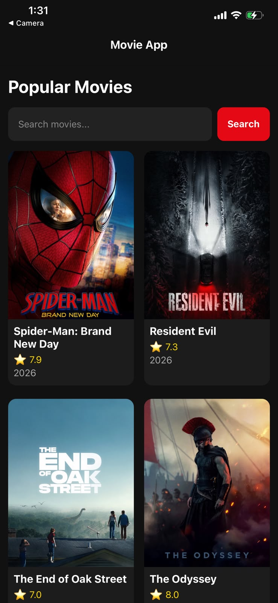
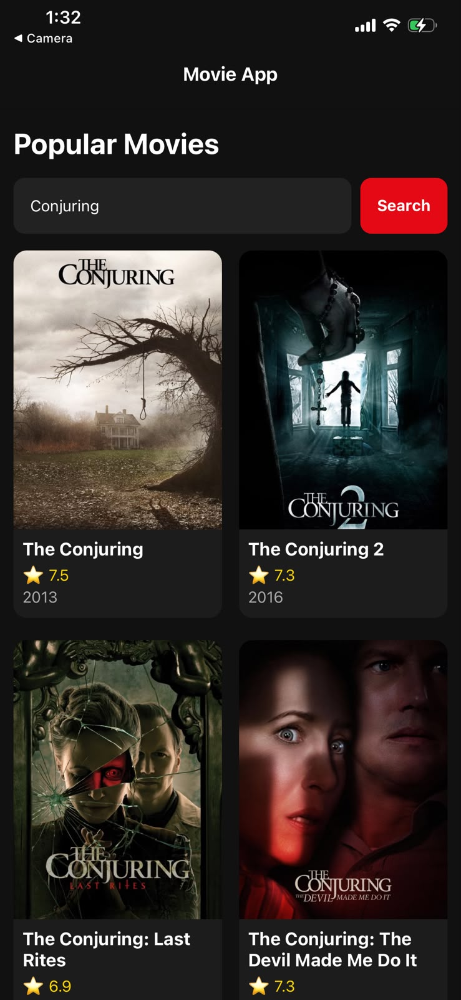

# Movie App

A React Native movie application built with Expo that allows users to discover popular movies, search for movies, and view detailed information about each movie.

## Screenshots

### Home Screen

<p align="center">
  
</p>

### Search Movies

<p align="center">
  
</p>

### Movie Details

<p align="center">
  
</p>

## Features

- Browse popular movies
- Search for movies
- View movie ratings
- View release dates
- View movie genres
- View movie runtime
- Read movie descriptions
- Responsive mobile interface
- Fetch movie data from the TMDB API

## Technologies

- React Native
- Expo
- JavaScript
- React Navigation
- TMDB API
- REST API
- FlatList
- Fetch API

## Getting Started

### Install dependencies

```bash
npm install